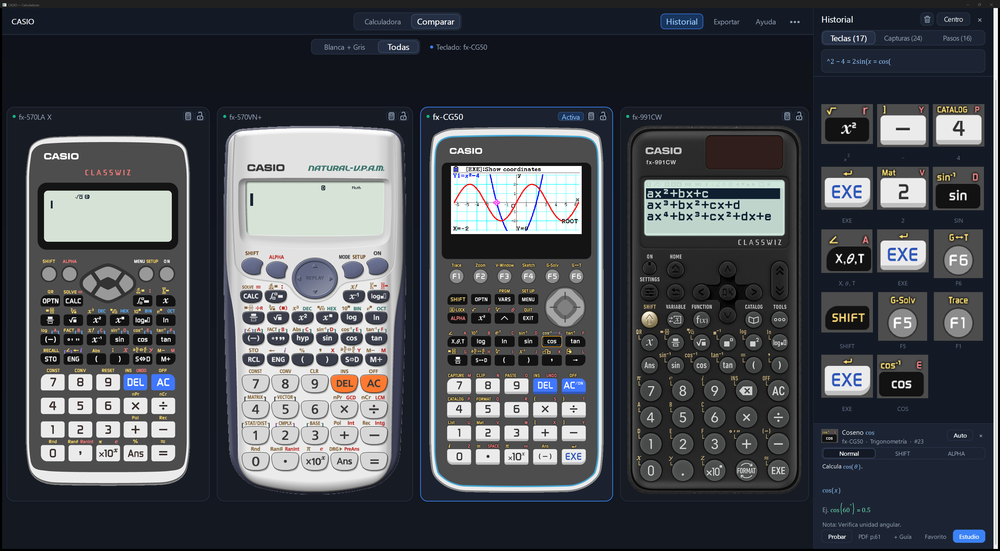
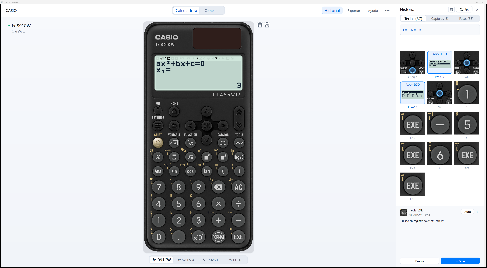
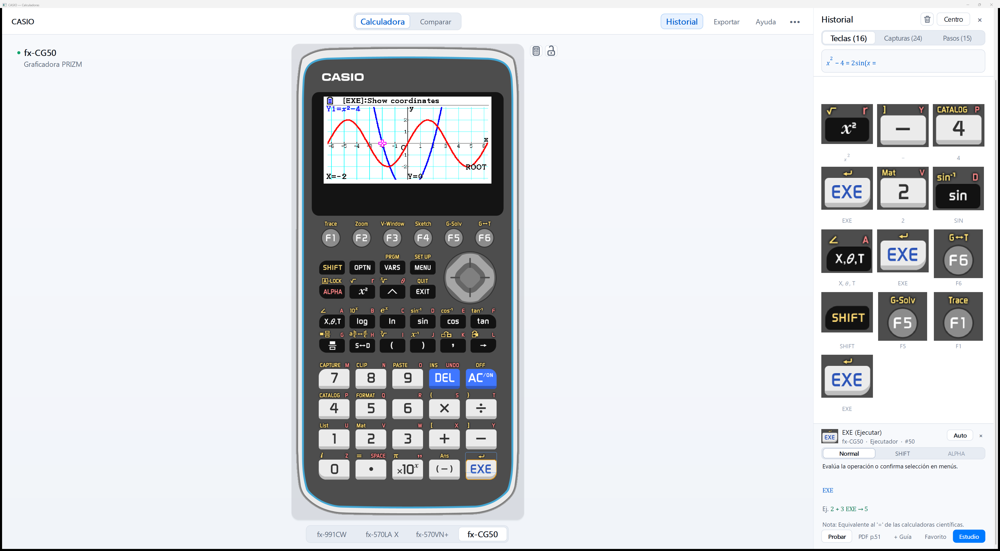
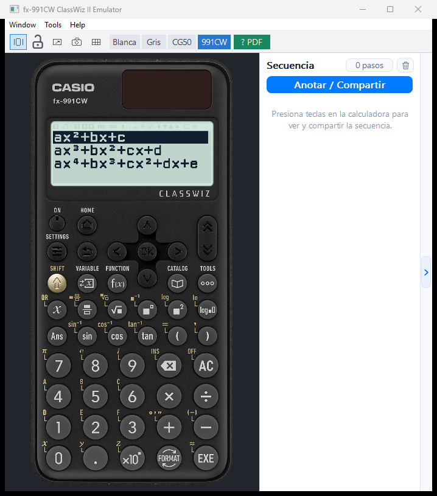
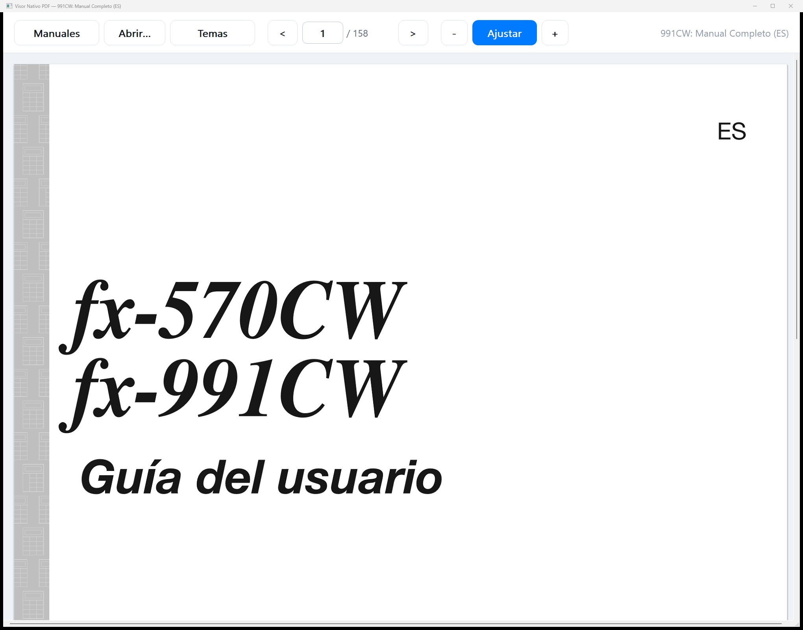

# Calculadora Unificada — Edición Core Oficial (Producción Win32)

Aplicación de producción para Windows (Win32 `x86`) que integra en un único ejecutable portable (`CalculadoraUnificada.exe`, CRT estático `/MT`) las **cuatro calculadoras científicas y graficadoras CASIO** sobre sus motores y firmwares originales (`fx-991CW ClassWiz II`, `fx-570LA X / 991LA X`, `fx-570VN PLUS / ES PLUS` y `fx-CG50 PRIZM`), con interfaz moderna **Porcelana Claro** y **Modo Oscuro**, renderizado matemático visual en **LaTeX 2D**, modo compacto vertical con cajón lateral expandible de secuencia, capturas automáticas pre-entrada (`App · LCD`), anotador gráfico a mano alzada y **Visor Nativo de PDF sin dependencias externas** sobre **16 manuales oficiales** (Hardware y Software, Español e Inglés).

---

## Vista previa de capturas (`docs/screenshots/`)

| Tema Porcelana Claro (4 calculadoras + Historial e Inspector) | Modo Oscuro (Comparación en vivo + Gráfica dual) |
| :---: | :---: |
|  |  |

| `fx-991CW` (Polynomial Solver + `App · LCD`) | `fx-CG50 PRIZM` (Gráfica dual + `G-Solv`) | Modo Compacto + Cajón de Secuencia | Visor Nativo PDF (`Windows.Data.Pdf`) |
| :---: | :---: | :---: | :---: |
|  |  |  |  |

---

## Características Principales

### 1. Cuatro Calculadoras Oficiales Integrados (`CalculadoraUnificada.exe`)
- **CASIO fx-991CW ClassWiz II (Negra)**:
  - Host nativo (`fx991cw_host.cpp`) integrando `runtime/fx991cw/emulator/casioemu.exe` (ventana `SDL_app` embebida) con overlay transparente interactivo para resaltado de hover/tecla activa (`WS_EX_LAYERED | WS_EX_TRANSPARENT | WS_EX_NOACTIVATE`), registro completo de pulsaciones en Historial y capturas automáticas previas al confirmar en menús (`Pre-OK` / `App · LCD`).
- **CASIO fx-570LA X / fx-991LA X ClassWiz (Blanca)**:
  - Núcleo `nX-U8` (`third_party/CalcEmuCore`) + ROM `roms/fx991lax.rom` embebida en recursos PE (`3001 RCDATA`).
  - Indicadores hardware Row-0 propios (`lcd_indicators.h` sobre malla nativa `192 x 8` con `COLORONCOLOR`: `[S]`, `[A]`, `M`, `STO`, `[Math]`, `[D]`/`[R]`/`[G]`, `FIX`, `SCI`, `E`, `i`, flechas de desplazamiento).
- **CASIO fx-570VN PLUS / fx-570ES PLUS Natural-V.P.A.M. (Gris)**:
  - Núcleo `nX-U8` + ROM `roms/fx570vnplus.rom` embebida en recursos PE (`3002 RCDATA`) + indicadores Row-0 propios en malla `288 x 12` (`lcd_indicators.h`).
- **CASIO fx-CG50 PRIZM (Graficadora Color)**:
  - Motor oficial CASIO 32-bit (`cg50_backend.cpp`) vía las DLL de `runtime/` (`GCalAppIF.dll`, `DLSim32E.dll`, `CPU73050.dll`, `LCDR61524A.dll`, `Key1616SwA.dll`, `CASIO GCSim.dll`, `ActivationFxMb.dll` y `fxCG50.dll`) + redistribuibles locales (`mfc100.dll`, `mfc100u.dll`, `msvcp100.dll`, `msvcr100.dll`) para portabilidad en equipos limpios.

### 2. Interfaz Apple HIG + Liquid Glass 2.0, Renderizado Matemático 2D y Modo Compacto
- **Sistema Visual Apple HIG & Liquid Glass 2.0 (`ui_theme.h`, `ui_glass/`)**:
  - Modos de apariencia **Claro**, **Oscuro** y **Alto Contraste (WCAG AAA)** con barra de título DWM adaptativa y bordes redondeados nativos en Windows 11.
  - Cápsulas flotantes ópticamente refractadas con desenfoque *Dual Kawase*, bisel de refracción espectral RGB (ley de Snell), reflexión especular de Fresnel, bordes concéntricos (`r_interno = máx(r_externo - padding, r_mín)`), control de opacidad (*Diseño*, *Equilibrado*, *Esmerilado Opaco*) y opción *Reducir Transparencia*.
  - Orbes vítreos de estado y tinta, chasis CASIO recortados por canal alfa con sombra de contacto sutil e iconografía vectorial GDI+ AntiAlias.
- **Motor Visual Subconjunto LaTeX 2D (`latex_math_renderer.h`)**: renderiza visualmente fracciones (`\frac`), raíces (`\sqrt`), integrales (`\int`), sumatorias (`\sum`), límites (`\lim`), potencias, subíndices, paréntesis adaptativos y letras griegas en Historial, Inspector, Centro de Estudio y Exportador sin exponer tokens `$...$` crudos.
- **Botones rápidos por calculadora (`main.cpp`)**: accesos vectoriales junto a cada chasis en vista Solo y Comparar para entrar/salir del modo ventana compacta (`[|O|]`) y fijar *Always on Top* (candado).
- **Modo Ventana Compacta Vertical + Cajón Expandible (`Ctrl+M` / `Ctrl+U`)**:
  - Muestra una única calculadora (`fx-991CW`, `fx-570/991LA X`, `fx-570VN PLUS` o `fx-CG50 PRIZM`) con pestaña lateral derecha expandible (**Secuencia**) para ver u ocultar la tira de pasos en vivo, botón de limpieza rápida (basurerito), capturas `App · LCD` pre-entrada, resaltado azul direccional en el D-pad/`REPLAY` de los 4 modelos y acceso directo a **Anotar / Compartir**.
- **Pop-up Display (`Ctrl+P`, `popup_display.h`)**:
  - Ventana flotante sincronizada en tiempo real (25 FPS) sobre dimensiones lógicas exactas del LCD con captura PNG/portapapeles, cuadrícula y escalado (`x1 / x2 / x3`).
- **Portapapeles Inteligente (`Ctrl+,`) e Historial (`F2`, `key_history_view.h`)**:
  - Copia persistente configurable en `config_unificada.ini` (**Solo Imagen** `CF_BITMAP`, **Solo Texto + LaTeX**, o **Ambas Simultáneamente**), miniaturas reales de botones con dirección D-pad y reproductor paso a paso (`|<`, `<`, `Reprod`, `>`, `>|`, exportación `./guias/reproductor_pasos/paso_XXX.png`).
- **Exportador de Guías y Anotador Mano Alzada (`Ctrl+E`, `settings_and_exporter.h`)**:
  - Selección de rango (`Desde #A` a `Hasta #B`), formatos predeterminados (`Explicada`, `Rápida`, `Práctica`, `Presentación`), notas editables con LaTeX 2D, herramienta de dibujo a mano alzada (`Lápiz`), texto/notas y formas vectoriales (`Texto`, `Flecha`, `Círculo`, `Marco`, `#N`), copia al portapapeles y exportación PNG/BMP.
- **Deshacer Coherente (`Ctrl+S` / `Ctrl+Z`)**:
  - Captura y restaura de forma atómica el estado binario de RAM junto con `KeyLog`, galería y ventanas.

### 3. Visor Nativo de PDF sin Dependencias, Referencia Offline y 16 Manuales Oficiales
- **Visor Nativo de PDF (`pdf_viewer.h`)**: implementado directamente en Win32 usando `Windows.Data.Pdf` (WinRT COM cargado dinámicamente en un hilo MTA dedicado, sin librerías de terceros ni navegador embebido), con paginación, zoom, barra de temas/índice y diálogo `Abrir...` para cualquier PDF externo.
- **Catálogo Determinista Offline (`knowledge_catalog.h`, `smart_help_view.h`, `learning_studio.h`, `manual_catalog.h`)**:
  - Capas `SHIFT`/`ALPHA` (`Ctrl+Shift+L`), Explorador Interactivo (`Ctrl+Shift+K`) y Centro de Estudio (`Ctrl+Shift+E`, pestaña `Manuales PDF (16)`) respaldados por `catalog/casio_knowledge_catalog.json` e índice de búsqueda sobre `manuales/indice_paginas_pdf.tsv`.

| Calculadora | Manuales Oficiales Incluidos en `manuales/` (`16` PDFs) | Tipo / Idioma |
| :--- | :--- | :--- |
| **Negra (`fx-991CW / fx-570CW`)** | `fx-570CW_991CW_ES.pdf` (158 pág.), `fx-570CW_991CW_EN.pdf` (151 pp.) | Usuario / HW & SW (ES / EN) |
| **Blanca (`fx-570LA X / 991LA X / EX`)** | `fx-570_991LA_X_ES.pdf` (49 pág.), `fx-570_991EX_ES.pdf` (48 pág.), `fx-570_991EX_EN.pdf` (46 pp.) | Hardware / Usuario (ES / EN) |
| **Blanca / Negra (Software Emulador)** | `ClassWiz_Emulator_Software_Users_Guide_ES.pdf` (88 pág.), `CASIO_Activation_Guide_ES.pdf` (112 pág.) | Software Emulador y Licencia (ES) |
| **Gris (`fx-570VN PLUS / ES PLUS`)** | `fx-570_991ES_PLUS_ES.pdf` (48 pág.), `fx-570_991ES_PLUS_EN.pdf` (46 pp.), `fx-570VN_PLUS_Hardware_Users_Guide.pdf` (62 pp.) | Hardware / Usuario (ES / EN) |
| **Graficadora (`fx-CG50 PRIZM`)** | `fx-CG50_Soft_v370_ES.pdf` (678 pág.), `fx-CG50_Soft_v370_EN.pdf` (677 pp.), `fx-CG50_Hard_ES.pdf` (17 pág.), `fx-CG50_Hard_EN.pdf` (17 pp.) | Software OS v3.70 y Hardware (ES / EN) |
| **Graficadora (Software Emulador)** | `fx-CG_Manager_PLUS_Software_Users_Guide_EN.pdf` (45 pp.), `fx-CG_Manager_PLUS_Activation_Guide.pdf` (270 pág.) | Software `fx-CG Manager PLUS` y Activación |

---

## Ejecución Portable y Línea de Comandos

```bat
iniciar.bat
```

Opciones soportadas por `CalculadoraUnificada.exe`:
- `CalculadoraUnificada.exe` — Vista principal unificada.
- `CalculadoraUnificada.exe --compact` — Modo ventana compacta (`fx-570/991LA X`).
- `CalculadoraUnificada.exe --compact-gray` — Modo ventana compacta (`fx-570VN PLUS`).
- `CalculadoraUnificada.exe --compact-cg50` — Modo ventana compacta (`fx-CG50 PRIZM`).
- `CalculadoraUnificada.exe --compact --popup` — Modo ventana compacta junto con *Pop-up Display*.
- `CalculadoraUnificada.exe --help-search` — Ayuda Inteligente y buscador de manuales PDF.

---

## Compilación y Verificación (`Win32 / MSVC`)

```bat
compilar.bat
```

O con CMake en árbol de verificación limpia (`Win32`, CRT estático `/MT`):
```powershell
cmake -S . -B build-verify -A Win32
cmake --build build-verify --config Release --clean-first
ctest --test-dir build-verify -C Release --output-on-failure --verbose
```

Suites automatizadas registradas en `CMakeLists.txt`:
- `Cg50BackendContract` (`tests/cg50_backend_contract_test.cpp`)
- `UiCoreModules` (`tests/ui_core_modules_test.cpp` — 11 módulos incluyendo `TestNativePdfViewerAll16Manuals`)

---

## Document Studio (Lienzo Infinito, Motor PDF, Laboratorio STEM y Módulos Académicos)

El subsistema **Document Studio** (`doc_studio/` en Windows `x64` Direct2D y `academic/` para herramientas universitarias) proporciona:
- **Interfaz Apple HIG + Liquid Glass 2.0**: barra superior con cápsulas flotantes refractadas, barra lateral *edge-to-edge* con miniaturas e iconos vectoriales semánticos, popover interactivo de Apariencia (*Claro / Oscuro / Alto Contraste*, deslizador continuo de opacidad del vidrio y *Reducir Transparencia*).
- **Tipografía Matemática Natural 2D y Teclas Gráficas CASIO**: renderizado tipográfico bidimensional de fracciones apiladas, raíces, integrales, sumatorias, letras griegas, unidades físicas y teclas físicas CASIO estilizadas en tarjetas STEM, circuitos y puente CASIO.
- **Escritura digital de baja latencia**, *Hold-to-Snap*, regla graduada `0°–360°`, borrador selectivo, *Study Tape*, *Ink Replay* sincronizado con audio WAV (`16-bit PCM`), etiquetas `#tags`, capas y repetición espaciada `SM-2`.
- **Motor matemático dimensional (`#varsub` / `#nosub` / `#novar`)**, fasores AC, álgebra matricial (`SEL`), superficies `3D` con paleta accesible `CVD`, simulador de circuitos **MNA** (`DC`, `AC`, diodos Shockley, osciloscopio transitorio, Laplace simbólico `H(s)` y mapas de Karnaugh), puente interactivo con las calculadoras CASIO (`Enviar -> Lienzo`) y exportación de **Memoria de Cálculo HTML5**.
- **Módulos Académicos Universitarios (`academic/`)**: conector de solo lectura para TEC Digital (consulta de cursos, anuncios, evaluaciones y materiales sin envío ni modificación remota) y optimizador de horarios **HorariosTEC** sin choques.
- Manual completo de funciones y sintaxis: [docs/MANUAL_DOCUMENT_STUDIO_INGENIERIA.md](docs/MANUAL_DOCUMENT_STUDIO_INGENIERIA.md).

