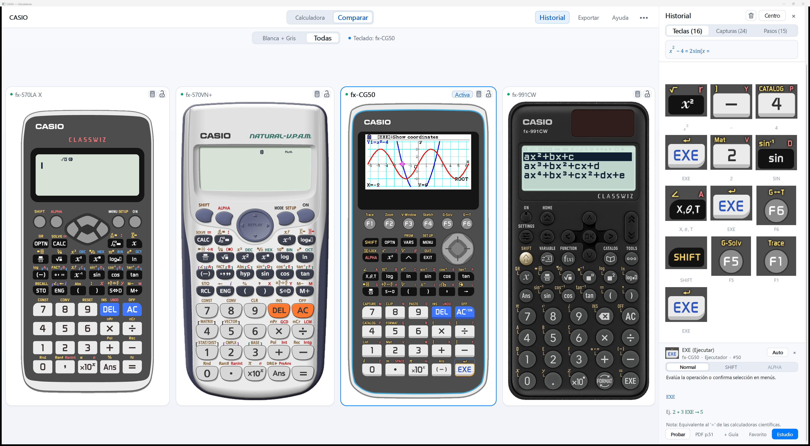

# Calculadora Unificada CASIO — Manual de Usuario y Características

**Calculadora Unificada CASIO** es una aplicación portátil para **Windows 10 y Windows 11** (sin instalación ni dependencias externas) que reúne en un mismo entorno las **4 calculadoras científicas y graficadoras CASIO más utilizadas**, herramientas visuales de enseñanza y estudio matemático, un **Visor de PDF integrado** con los **16 manuales oficiales** y el módulo avanzado **Document Studio** para edición de documentos PDF y notas en lienzo infinito.

---

## Vista previa de la aplicación

### Comparación en paralelo, historial y tema Porcelana Claro

### Modo Oscuro completo

---

## Calculadoras integradas y capacidades

| Modelo | Serie / Estilo | Funciones principales incluidas | Capturas |
| :--- | :--- | :--- | :---: |
| **CASIO fx-991CW** | ClassWiz II (Negra) | Cálculo exacto con fracciones, raíces, trigonometría, matrices, vectores, estadística, distribuciones, hoja de cálculo, *Polynomial Solver*, código QR y capturas de secuencia `App · LCD` | [Cálculo](docs/screenshots/01_fx991cw_complex_calc.png) · [Solver](docs/screenshots/02_fx991cw_poly_roots.png) |
| **CASIO fx-570LA X** | ClassWiz (Blanca) | Fracciones anidadas, logaritmos en cualquier base, trigonometría exacta, combinatoria (`nCr` / `nPr`), complejos, tabla de valores y generación de código QR (`SHIFT + OPTN`) | [Fracciones](docs/screenshots/03_fx570lax_complex_frac.png) · [Complejos](docs/screenshots/04_fx570lax_complex_cmplx.png) · [nCr](docs/screenshots/04a_fx570lax_comb.png) |
| **CASIO fx-570VN+** | Natural-V.P.A.M. (Gris) | Fracciones exactas, raíces, integrales/derivadas numéricas, trigonometría, combinatoria y números complejos con seguimiento visual sobre teclas y cursor `REPLAY` | [Fracciones](docs/screenshots/05_fx570vn_complex_frac.png) · [Complejos](docs/screenshots/06_fx570vn_complex_cmplx.png) · [nCr](docs/screenshots/06a_fx570vn_comb.png) |
| **CASIO fx-CG50** | PRIZM Color (Graficadora) | Pantalla a color, gráficos múltiples, tabla y resolución gráfica interactiva (`G-Solv`: raíces, intersecciones, máximos/mínimos, integrales), eActivities y aplicaciones integradas | [Gráficos](docs/screenshots/07_fxcg50_dual_graph.png) · [G-Solv](docs/screenshots/08_fxcg50_gsolv_root.png) |

---

## Funciones y herramientas incluidas

### 1. Modos de visualización y espacio de trabajo
- **Modo Calculadora / Comparar**: visualiza las 4 calculadoras a la vez (`F6`), vista dual Blanca + Gris (`F5`) o un solo modelo enfocado (`Solo Blanca`, `Solo Gris F3`, `Solo fx-CG50 F4`, `Solo fx-991CW F7`).
- **Ventana Compacta Vertical (`Ctrl+M`)**: reduce la ventana a una sola calculadora ideal para compartir pantalla o mantenerla al lado de tus apuntes, con cajón lateral desplegable de historial y miniaturas ([ver captura](docs/screenshots/12_compact_991cw_drawer.png)).
- **Pantalla LCD Flotante (`Ctrl+P`)**: abre una ventana independiente ampliada del LCD activo con marco opcional ([ver captura](docs/screenshots/11_popup_display.png)).
- **Siempre Visible / Always on Top (`Ctrl+T`)**: mantiene la calculadora por encima de cualquier navegador, editor o presentación.
- **Temas visuales y escalado**: alterna entre **Tema Porcelana Claro** y **Modo Oscuro**, y ajusta tanto el tamaño de la interfaz (`Auto`, `100%`–`200%`) como el zoom de las calculadoras.

### 2. Aprendizaje, historial y enseñanza en pantalla
- **Historial visual y Reproductor Paso a Paso (`F2`)**: registra cada tecla pulsada con su secuencia en **LaTeX 2D**, vista de capas y reproductor paso a paso con miniaturas ([ver Inspector](docs/screenshots/10_inspector_latex_layers.png) · [ver Reproductor](docs/screenshots/10b_inspector_hist_panel.png)).
- **Capas `SHIFT` / `ALPHA` (`Ctrl+Shift+L`) y Explorador de Teclas (`Ctrl+Shift+K`)**: muestra visualmente qué funciones secundarias activa cada tecla sobre el cuerpo de la calculadora y resalta la última tecla pulsada en **Modo Presentación**.
- **Centro de Estudio CASIO (`Ctrl+Shift+E`)**: incluye tarjetas de estudio con fórmulas en LaTeX 2D, comparador de equivalencias entre ClassWiz / ES PLUS / fx-CG50, diagnóstico de pantalla (*¿Por qué muestra esto?*), perfiles y checklist de verificación previo ([ver captura](docs/screenshots/13_learning_studio_latex.png)).
- **Exportador de Guías (`Ctrl+E`)**: convierte tu secuencia de teclas en una guía lista para copiar o compartir ([ver captura](docs/screenshots/15_exporter_latex_guide.png)).
- **Portapapeles Inteligente y Capturas**: copia el resultado con `Ctrl+C`, guarda capturas limpias del LCD en formato PNG (`Ctrl+L`, zoom configurable `x1`/`x2`/`x3`), genera códigos QR ClassWiz (`SHIFT + OPTN`) y guarda/restaura el estado de la calculadora (`Ctrl+S` / `Ctrl+Z`).

### 3. Ayuda Inteligente y Visor Nativo de PDF (`F1`)
- **Buscador unificado (`F1`)**: busca al instante procedimientos y temas (ecuaciones, matrices, integrales, 3D, contraste, reset, códigos QR) filtrando por modelo y abriendo el manual correspondiente ([ver captura](docs/screenshots/14_smart_help_manuals.png)).
- **Visor Nativo de PDF**: lee cualquiera de los **16 manuales oficiales** (o cualquier PDF externo mediante **Abrir...**) directamente dentro de la aplicación, con cambio rápido de página, ajuste a pantalla/zoom, tema claro/oscuro y botón **`Estudio PDF`** para enviarlo al editor avanzado ([ver Visor Claro](docs/screenshots/16_pdf_991cw_es.png) · [ver Visor Oscuro](docs/screenshots/23_dark_theme_pdf_viewer.png)).

### 4. Document Studio (`DocumentStudio.exe`) — Editor PDF y Lienzo Infinito
Incluido junto a la calculadora y accesible desde el botón **`Estudio PDF`** del visor, desde **`Tools -> Abrir Document Studio`** o ejecutando `DocumentStudio.exe`:
- **Modo PDF Paginado y Lienzo Infinito (`Lienzo ∞`)**: anota directamente sobre páginas PDF con miniatura lateral o trabaja en una pizarra ilimitada con zoom, paneo libre y papel configurable ([ver Editor PDF](docs/screenshots/25_document_studio_pdf_editor.png) · [ver Lienzo Infinito](docs/screenshots/26_document_studio_infinite_canvas.png)).
- **Herramientas de dibujo y edición**: pluma, resaltador, borrador, rectángulo, flecha, cuadros de texto, inserción de imágenes (`+Img`), selección/recorte, rotación `90°`, agregar/eliminar páginas, y deshacer/rehacer (`Ctrl+Z` / `Ctrl+Y`).
- **Gestión de archivos PDF y Office**: abre archivos arrastrándolos a la ventana o con `Ctrl+O`, guarda proyectos de trabajo (`.cudoc` con respaldo automático `.bak`), exporta a PDF con anotaciones, **combina** varios PDFs, **divide** por rangos de páginas e **imprime** (`Ctrl+P`).
- **Búsqueda, OCR, Office y Firma Digital**: busca y reemplaza texto (`Ctrl+F` / `F3`), extrae texto de imágenes o páginas escaneadas sin internet (**OCR**), importa/exporta **Word (`.docx`)** y **PowerPoint (`.pptx`)**, y **firma o verifica** documentos PDF con firma digital SHA-256.

---

## Cómo ejecutar (versión portátil sin instalación)

### Requisitos
- **Sistema operativo**: Windows 10 o Windows 11 (64 bits).
- **Instalación**: No requiere instalador ni programas externos de PDF.

### Inicio rápido
1. Descomprime el paquete portátil (o clona el repositorio).
2. Haz doble clic en **`iniciar.bat`** o abre **`CalculadoraUnificada.exe`**.
3. Para abrir directamente el editor documental, haz clic en **`Estudio PDF`** dentro del visor de manuales o ejecuta **`DocumentStudio.exe`**.

### Opciones por línea de comandos

**`CalculadoraUnificada.exe`**
- `--compact`: inicia en modo Ventana Compacta Vertical (Blanca `fx-570LA X`).
- `--compact-gray`: inicia en Ventana Compacta mostrando la Gris (`fx-570VN+`).
- `--compact-cg50`: inicia en Ventana Compacta mostrando la Graficadora (`fx-CG50`).
- `--compact-cw`: inicia en Ventana Compacta mostrando la Negra (`fx-991CW`).
- `--popup`: abre automáticamente la pantalla LCD flotante.
- `--help-search="tema"`: abre la Ayuda Inteligente con una búsqueda directa.

**`DocumentStudio.exe`**
- `--open <ruta>`: abre al inicio un archivo `.pdf`, `.cudoc`, `.docx` o `.pptx`.
- `--page <N>`: abre directamente en la página indicada (ej. `--page 5`).
- `--mode pdf|canvas`: elige iniciar en vista paginada (`pdf`) o Lienzo Infinito (`canvas`).

---

## Atajos de teclado principales

### Calculadora Unificada
| Atajo | Acción |
| :--- | :--- |
| `F1` | Abrir Ayuda Inteligente y catálogo de los 16 manuales PDF |
| `F2` | Abrir Reproductor Visual Paso a Paso |
| `F3` / `F4` / `F7` | Cambiar a calculadora Gris (`F3`), fx-CG50 (`F4`) o fx-991CW (`F7`) |
| `F5` / `F6` | Vista Dual Blanca + Gris (`F5`) o Mostrar las 4 calculadoras (`F6`) |
| `Ctrl+M` / `Ctrl+U` | Alternar Ventana Compacta Vertical (`Ctrl+M`) o Modo Estudio Unificado (`Ctrl+U`) |
| `Ctrl+P` / `Ctrl+T` | Pantalla LCD Flotante (`Ctrl+P`) / Siempre Visible (`Ctrl+T`) |
| `Ctrl+C` / `Ctrl+L` | Copiar resultado inteligente (`Ctrl+C`) / Capturar pantalla LCD a PNG (`Ctrl+L`) |
| `Ctrl+E` | Abrir Exportador de Guías de Secuencia |
| `Ctrl+S` / `Ctrl+Z` | Guardar estado actual de la calculadora (`Ctrl+S`) / Restaurar estado (`Ctrl+Z`) |
| `Ctrl+Shift+E` | Abrir Centro de Estudio CASIO |
| `Ctrl+Shift+K` / `Ctrl+Shift+L` | Explorador Interactivo de Teclas / Superponer capas `SHIFT` y `ALPHA` |
| `Ctrl+,` | Abrir Configuración de Portapapeles y Presentación |

### Document Studio
| Atajo | Acción |
| :--- | :--- |
| `Ctrl+O` / `Ctrl+S` | Abrir documento (`Ctrl+O`) / Guardar proyecto `.cudoc` (`Ctrl+S`) |
| `Ctrl+Z` / `Ctrl+Y` | Deshacer / Rehacer |
| `Ctrl+F` / `F3` | Buscar texto en el PDF / Siguiente coincidencia |
| `Ctrl+P` | Imprimir documento |

---

## Manuales oficiales incluidos (`manuales/`)

Todos los manuales se encuentran dentro de la carpeta `manuales/` y pueden consultarse sin conexión desde el menú **`Help`** o pulsando **`F1`**:

| Archivo | Contenido | Idioma | Páginas |
| :--- | :--- | :---: | :---: |
| `fx-570CW_991CW_ES.pdf` | Guía del Usuario Oficial fx-570CW / fx-991CW | ES | 158 |
| `fx-570CW_991CW_EN.pdf` | Official User's Guide fx-570CW / fx-991CW | EN | 151 |
| `fx-570_991LA_X_ES.pdf` | Guía del Usuario Oficial fx-570LA X / fx-991LA X | ES | 49 |
| `fx-570_991EX_ES.pdf` | Guía del Usuario Oficial fx-570EX / fx-991EX | ES | 48 |
| `fx-570_991EX_EN.pdf` | Official User's Guide fx-570EX / fx-991EX | EN | 46 |
| `fx-570_991ES_PLUS_ES.pdf` | Guía del Usuario Oficial fx-570ES PLUS / fx-991ES PLUS | ES | 48 |
| `fx-570_991ES_PLUS_EN.pdf` | Official User's Guide fx-570ES PLUS / fx-991ES PLUS | EN | 46 |
| `fx-570VN_PLUS_Hardware_Users_Guide.pdf` | Manual Oficial Completo fx-570VN PLUS Natural-V.P.A.M. | EN | 62 |
| `fx-CG50_Soft_v370_ES.pdf` | Guía del Usuario Completa Software y Funciones fx-CG50 OS v3.70 | ES | 678 |
| `fx-CG50_Soft_v370_EN.pdf` | Complete Software & Operations User's Guide fx-CG50 OS v3.70 | EN | 677 |
| `fx-CG50_Hard_ES.pdf` | Guía del Usuario de Hardware fx-CG50 | ES | 17 |
| `fx-CG50_Hard_EN.pdf` | Hardware User's Guide fx-CG50 PRIZM | EN | 17 |
| `ClassWiz_Emulator_Software_Users_Guide_ES.pdf` | Guía del Usuario Software ClassWiz Emulator Subscription v2.0 | ES | 88 |
| `CASIO_Activation_Guide_ES.pdf` | Guía Oficial de Activación y Licencia Emulador CASIO | ES | 112 |
| `fx-CG_Manager_PLUS_Software_Users_Guide_EN.pdf` | Software User's Guide fx-CG Manager PLUS Subscription | EN | 45 |
| `fx-CG_Manager_PLUS_Activation_Guide.pdf` | Guía Oficial de Activación fx-CG Manager PLUS | EN | 270 |
